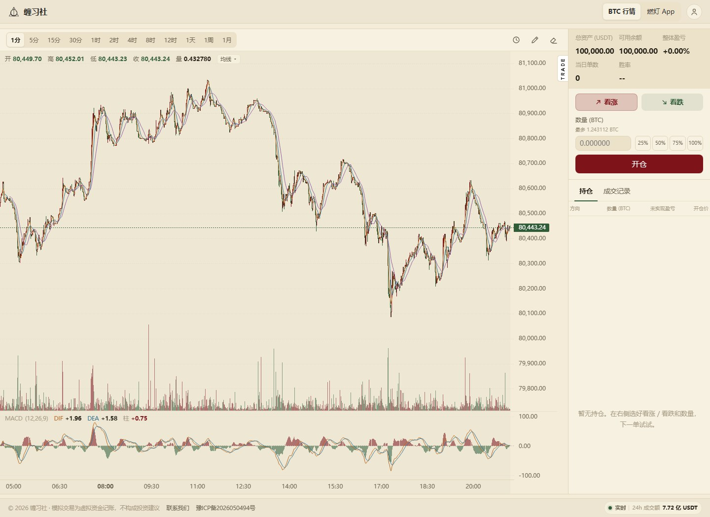

# BTC 行情页：均线 / MACD / 画线 / 历史单 与看盘布局

> 状态：已实现并上线（2026-10-25，`trade.js?v=c26e3358`）
> 涉及文件：`site/index.html`、`site/assets/trade.css`、`site/assets/js/trade.js`、
> `site/assets/icon-round.png`、`cloudfunctions/api/trade.js`、`tools/trade_page_test.js`

页面：<https://aibuilder.top/>（BTC 行情 / 模拟盘）

## 一、页面上有什么



| 位置 | 内容 | 默认 | 怎么用 |
| --- | --- | --- | --- |
| 主图 | 均线 MA | MA5 / MA10 / MA20 | 均线数值下拉里左键隐藏/显示，右键改周期/颜色/删除 |
| 图内 | 均线数值 | 收起 | 点 OHLC 右侧「均线 ▾」展开，一行一条；底部有「＋ 添加均线」 |
| 副图 | MACD、成交量 | 都显示 | 在 K 线上右键 →「副图」里选隐藏 / 显示 |
| 周期 | 12 档 | 1 分钟 | 1/5/15/30 分、1/2/4/8/12 时、1 天、1 周、1 月 |
| 右上工具 | 历史单 / 画线 / 擦除 | — | 三个图标，见第六、七节 |
| 右侧分割线外 | TRADE 小竖条 | 展开 | 点一下把**整个右侧面板**收起，走势图铺满全宽；再点展开 |
| 右上角 | 站点入口 + 头像 | — | BTC 行情、燃灯 App、账户头像菜单（含重置资金） |
| 页脚 | 实时状态 | — | 和「联系我们」同一行，靠最右，小胶囊，不压分隔线 |

## 二、均线

- **入口只保留一处**：图内 OHLC 右侧的「均线 ▾」，顶部周期条不再放 MA 按钮。
- 展开后一行一条：`MA5 80,xxx`，底部「＋ 添加均线」。
- **左键点一行**：隐藏 / 显示这条均线（隐藏的线不画，行变淡划线）。
- **右键点一行**：弹出编辑小页，可改周期、选颜色（12 色 + 自定义）、隐藏、删除。
- **改周期**：5/10/20/30/60/120 或 2-250；被占用的周期置灰。
- **添加**：下拉底部「＋ 添加均线」，最多 6 条。
- **删除**：编辑页「删除这条均线」，或右键 K 线上的均线（7px 内）直接删。
- 隐藏、颜色、周期都写进 `localStorage`。

## 三、TRADE 折叠与拖动分隔条

- 竖条在**开仓区域左边界的外侧**（走势图右侧、分割线上），22×54px 白底黑字。
- 点一下：整个 `.desk-side`（账户 + 下单 + 持仓/成交记录）全部收起，
  走势图自动铺满全宽；竖条留在屏幕右边缘，再点恢复。
- 图表右侧预留 22px 装竖条，价格轴刻度不会被挡住。
- **右侧面板默认宽度缩小三分之一**：约 288px（原 430px）。
- **拖动分隔条**：在走势图和右侧面板的边界左右拖，实时改宽度（270-720px），
  图表自动跟着缩放；双击分隔条恢复 288px；宽度记在 `localStorage`。
- 面板被拖窄时，表格自动换成小号字（容器查询），尽量一屏放下。

## 四、下单、平仓与账户

- **数量 + 百分比同一行**：左边 BTC 数量输入框（变窄，高度和百分比按钮一样 30px），
  右边 25/50/75/100%。
- **开仓按钮**占满整行（约两个「看涨」按钮的宽度），高度 38px。
- **100% 一定能开**：数量向下取整到 6 位；下单时如果价格刚好跳了一点，
  差额在 0.5% 内自动按可用余额截一下，不会弹「余额不足」。
- **平仓可选比例**：点持仓里的「平仓」弹出 25/50/75/100%，
  按当前价平掉对应比例；部分平仓后剩余持仓的 `qty`、`margin` 按比例保留。
- **盈亏放大 10 倍**：`PNL_MULT = 10`，客户端浮动/平仓盈亏、云端平仓/强平一致；
  保证金/名义价值不变。
- **账户五个指标**（总资产、可用余额、整体盈亏、当日单数、胜率）同一套单元格样式。
- **重置资金**：头像菜单 →「重置资金」→ 确认后现金回到 100,000，
  清空持仓和挂单；**成交记录、当日单数、胜率保留**；整体盈亏按新本金重新算（归零）。
- 平仓不再弹二次确认；登录/绑定手机/退出仍在头像菜单。

## 五、成交记录

- 一开一平合成一条；部分平仓按每次平仓各算一条，用 `posId` 和开仓配对。
- 列：时间、方向、盈亏、开仓价、平仓价、数量。
- **分页**：默认 8 条，底部「查看更多」，每次再加 8 条；没有更多时按钮隐藏。
- **点任意一条记录**：图上把这一笔的开仓点、平仓点用同色圆点闪一下（约 2.4 秒）。

## 六、历史单标记（三个图标中的时钟）

- 点「历史单」图标：在 K 线上画出所有成交记录的开/平仓点。
- 所有开平仓点统一用**黑色圆点**，两点之间一条细黑线，圆点落在对应 K 线上。
- 再点一次关闭；按钮激活时右下角有红点。
- 三个工具按钮（历史/画线/擦除）尺寸加大到 34×32，图标 18px。
- 开平仓时间会吸附到最近一根 K 线，切周期后仍能定位。

## 七、画线 / 擦除（铅笔 / 橡皮图标）

- 「画线」：点一下激活（右下角红点），在 K 线上拖动**自由画曲线**；
  松开后自动退出激活。
- **按住 Shift 拖动**：只画起点到终点的直线。
- 「擦除」：清空全部画线。
- **Ctrl+Z / ⌘+Z**：撤销上一次画线或擦除；焦点在输入框里时不拦截。
- 线存 `(时间, 价格)` 点列，平移/缩放/切周期后仍钉在原位；覆盖层平时不吃鼠标事件。

## 八、图表外观

- 网格：只保留横向虚线，颜色 `#E7DCC3`，竖向网格线去掉。
- 去掉左下角的 TradingView 标识（`layout.attributionLogo: false`）。
- 成交量和 MACD 的显示/隐藏改到**右键菜单 →「副图」**；原来的两个图标按钮已删除。
- 主图/副图仍是两个 chart 实例，时间轴只画在副图，区间和十字线双向镜像。

## 九、布局、导航、页脚

- **一整块**：左边 K 线，右边账户 + 下单 + 持仓，中间一条分隔线；面板左右无边框。
- 右侧默认约 288px，可拖动中间分隔条改宽窄（270-720px），双击恢复默认。
- **导航**：品牌「缠习社」和右侧两个入口文字颜色 `#2c2c2c`。
- **页脚**：版权、联系我们、ICP 备案 + 右侧小号实时状态（连接状态 + 24h 成交额），
  同一行、不压分隔线；隐私政策/用户协议不在行情页。
- **标签页图标**：`assets/icon-round.png`（圆角）。
- **窄屏**（≤980px）：退回文档流，K 线在上，账户/下单/持仓在下；TRADE 仍可收起右侧。

## 十、代码位置（`site/assets/js/trade.js`）

| 区块 | 函数 / 常量 | 作用 |
| --- | --- | --- |
| 常量 | `TF`、`PNL_MULT`、`HIS_PAGE`、`MA_PRESETS`、`MA_SWATCHES` | 周期、10 倍盈亏、分页、色板 |
| 均线 | `addMa` / `removeMa` / `changeMaPeriod` / `setMaHidden` / `syncMaSeries` | 增删改、隐藏 |
| 图例 | `buildMaLegend` / `showInd` | 均线下拉、数值 |
| 浮层 | `openMaPop` / `openCtx` / `openClosePop` | 编辑、右键、平仓比例 |
| 画线 | `drawInit` / `setDrawActive` / `onDrawDown/Move/Up` / `eraseDrawings` / `undoDrawings` | 自由曲线、Shift 直线、撤销 |
| 历史单 | `setHistActive` / `drawTradesOn` / `nearestBarTime` / `flashTrade` | 开平仓点、闪烁 |
| 交易统计 | `roundTrips` / `tradeStats` / `unrealized` | 配对、胜率、10 倍盈亏 |
| 账户 | `resetFunds` / `localClose` / `closePos` | 重置、部分平仓 |
| 时间轴 | `applyChartTimeFormat` / `applyTimeAxis` | 周/月刻度 |

## 十一、验证

```powershell
node tools/trade_page_test.js
```

61 项检查，含：

- 均线增删改、换色、隐藏、12 档周期；
- `roundTrips` 两开两平 → 两单、胜率 50%；部分平仓按 `posId` 配对；
- `unrealized` 多头/空头都放大 10 倍；
- 成交量开关、推送更新、悬停读数不被冲掉。

手动检查：

1. 点右侧分割线外的 TRADE → 整个右侧收起、走势图全宽；再点恢复；
2. 拖中间分隔条左右改宽，双击恢复 288px；
3. 「均线 ▾」左键隐藏/显示，右键改颜色；底部「＋ 添加均线」；
4. 点 100% → 开仓 → 不再提示余额不足；
5. 持仓「平仓」→ 50% → 剩余数量减半；再平 100% → 清空；
6. 成交记录默认 8 条，点「查看更多」继续加载；点某条记录图上黑点闪烁；
7. 时钟图标显示全部开平仓黑点；铅笔自由画，Shift 拖直线；橡皮 / Ctrl+Z；
8. 头像菜单「重置资金」→ 现金 10 万、持仓清空、历史与胜率保留、盈亏归零。

## 十二、改参数

```js
var TF = ['1m', '5m', '15m', '30m', '1h', '2h', '4h', '8h', '12h', '1d', '1w', '1M'];
var PNL_MULT = 10;
var HIS_PAGE = 8;
var MA_PRESETS = [5, 10, 20, 30, 60, 120];
var MA_MAX = 6;
var MACD = { fast: 12, slow: 26, signal: 9 };
```

改完跑测试并重新构建：

```powershell
node tools/trade_page_test.js
python tools/build_site.py --sync
tcb hosting deploy site/dist -e randeng-d8gs968w22a3d98e8
# 改了 cloudfunctions/api/trade.js 时还要：
tcb fn code update api -e randeng-d8gs968w22a3d98e8
```

## 十三、已知边界

- 只做 MA + MACD；BOLL、KDJ、RSI 还没做，MACD 参数写死。
- 均线最多 6 条，周期 2-250，颜色可以重复。
- 画线/历史单只存在当前页面，刷新后画线不保留。
- 成交记录客户端最多存 60 条原始记录，分页只是显示层。
- 部分平仓的每次平仓各算一单，胜率按平仓次数统计。
- 表格放不下时靠滚轮左右滚，没有拖拽滚动条。
