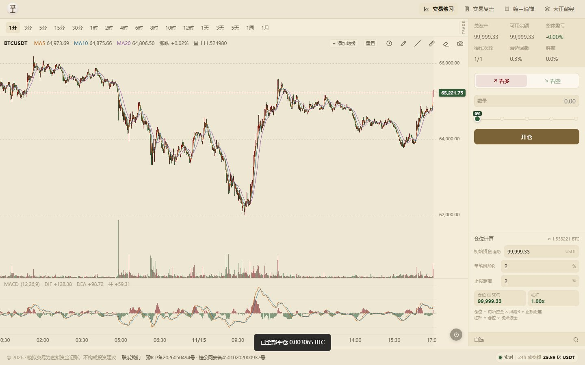

# BTC 行情页：均线 / MACD / 画线 / 历史单 与看盘布局

> 状态：已实现并上线（2026-10-25，`trade.js?v=c26e3358`）
> 2026-11-15：底部「持仓 / 历史记录」收窄到走势图右边界，腾出的右侧空间并进右侧一列
> （账户 + 下单 + 持仓明细 + 仓位计算 + 自选，自选钉在最下边缘），新增仓位计算区块；
> 持仓概览的四个合计格子（持仓市值 / 未实现盈亏 / 占用保证金 / 可用余额）和标题、笔数徽标已去掉，
> 只留持仓明细，没持仓时整块不显示。
> 涉及文件：`site/index.html`、`site/assets/trade.css`、`site/assets/js/trade.js`、
> `site/assets/icon-round.png`、`cloudfunctions/api/trade.js`、`tools/trade_page_test.js`

页面：<https://aibuilder.top/>（BTC 行情 / 模拟盘）

## 一、页面上有什么



| 位置 | 内容 | 默认 | 怎么用 |
| --- | --- | --- | --- |
| 主图 | 均线 MA | MA5 / MA10 / MA20 | 点图例里的均线数值改周期/颜色/隐藏/删除 |
| 图内 | 均线数值 + 涨跌 / 量 | 都显示 | 均线接在币种后面（原来开高低收的位置），隐藏的变淡划线；右侧「＋ 添加均线」 |
| 副图 | MACD、成交量 | 都显示 | 在 K 线上右键 →「副图」里选隐藏 / 显示 |
| 周期 | 12 档 | 1 分钟 | 1/5/15/30 分、1/2/4/8/12 时、1 天、1 周、1 月 |
| 右上工具 | 历史单 / 画线 / 擦除 | — | 三个图标，见第六、七节 |
| 右侧一列 | 账户 / 下单 / 持仓明细 / 仓位计算 / 自选 | 常驻 | 从顶部一直铺到页面底部（`--side-w`，默认 288px）；自选钉在这一列的最下边缘；持仓明细没单时不占位 |
| 走势图右下角 | 「历史」悬浮圆钮 | 常驻 | 30px 半透明小圆钮；点开贴着**走势图右边界**往左滑出历史记录（平仓单），和交易笔记同一个滑出样式；再点或 Esc 收起 |
| 走势图右侧外 | TRADE 小竖条 | 展开 | 点一下把**整个右侧面板**收起，走势图铺满全宽；再点展开 |
| 右上角 | 站点入口 + 头像 | — | BTC 行情、燃灯 App、账户头像菜单（含重置资金） |
| 页脚 | 实时状态 | — | 和「联系我们」同一行，靠最右，小胶囊，不压分隔线 |

## 二、均线与图例

- **图例就是入口**：走势图左上角那行 = `币种 + 均线数值 + 涨跌 + 量`。
  开/高/低/收四项已去掉，空出来的位置留给均线读数，不再有「均线 ▾」下拉。
- 均线读数按添加顺序一行排开：`MA5 80,xxx`；窄屏（≤760px）自动换行，按钮换到下一行。
- **隐藏的均线不消失**：数值照常显示，只是变淡 + 删除线（`is-off`），和编辑页里的隐藏样式一致。
- **点一条均线读数**：弹出编辑小页，可改周期、选颜色（12 色 + 自定义）、隐藏 / 显示、删除。
- **＋ 添加均线**：图例右侧的按钮，点开选 5/10/20/30/60/120 或自定义 2-250；
  被占用的周期置灰，最多 6 条。
- **删除**：编辑页「删除这条均线」，或右键 K 线上的均线（7px 内）直接删。
- 隐藏、颜色、周期都写进 `localStorage`。
- **手机上**图例只留 `币种 + 均线读数 + 涨跌`，成交量数值（量）不占地方（`.mob .lg-vol` 隐藏）。

## 三、TRADE 折叠与拖动分隔条

- 竖条在**开仓区域左边界的外侧**（走势图右侧、分割线上），22×54px 白底黑字。
- 点一下：整个 `.desk-side`（账户 + 下单 + 持仓明细 + 仓位计算 + 自选）全部收起，
  走势图铺满全宽；竖条留在屏幕右边缘，再点恢复。
- 左列只有走势图（底部那块「持仓 / 历史记录」已经去掉，持仓看右侧明细，
  历史记录看走势图右下角的「历史」圆钮），所以走势图一直铺到页面底部。
- 图表右侧留一条价格轴（桌面 70px）：上面是**自己画的横向虚线 + 价格刻度**，
  按当前可见价格范围取 3～5 条（`drawPriceAxis()` 用 1/2/5×10ⁿ 的步长），
  **不会像图表库自带那样挤满**；这条价格轴本身就是鼠标上下拖拽的「压扁 / 拉伸」区域。
- **右侧面板默认宽度缩小三分之一**：约 288px（原 430px）。
- **拖动分隔条**：在走势图和右侧面板的边界左右拖，实时改宽度（270-720px），
  图表和持仓表一起跟着缩放；双击分隔条恢复 288px；宽度记在 `localStorage`。
- 面板被拖窄时，表格自动换成小号字（容器查询），尽量一屏放下。

## 四、下单、平仓与账户

- **方向条 + 一个「开仓」按钮**：下单区最上面是 `#FBF7EE` 底的圆角条（圆角 8px、高 38px），
  外壳比里面的选项大一圈：选项本身 30px 高、四边留 3px，选中块不贴胶囊边。
  里面 `↗ 看多`（红）/ `↘ 看空`（绿）；选中一侧整块填浅红（多）/
  加深一点的浅绿（空，`rgba(48,92,56,.2)`），另一侧淡到 50%；
  点一下、按住左右滑、键盘 ← → 都能切。
  最底下一个 `#7B6337` 棕金色的「开仓」按钮按选中的方向开仓
  （原来的「开仓 / 平仓」模式切换已去掉）。
- **按金额下单（USDT）**：输入框整行铺满，左边一个静态的「数量」小字、右边一个灰色的
  小一号 `USDT`（`数量   25000.00 USDT`，单位是单独的静态文字，不参与编辑、不用手动敲）；
  开仓时按当前价换算成 BTC（向下取到 6 位）再下单，提示里同时给出「已开仓 x BTC（y USDT）」。
- **金额框在上、百分比滑杆在下**：两行都铺满整行（框拉长、滑杆也拉长好拖）；
  滑杆 30px 高，横线 / 圆点居中，百分比气泡收在里面；
  25/50/75/100% 是「可用余额的比例」（`maxAmount() = cash / (1 + FEE)`，
  手续费含在这笔钱里，100% 一定下得出去）。
- **平仓就两个字「平仓」**：在持仓明细最下面一条，和「开仓」按钮同款、通栏满宽；
  点了按市价把所有持仓一次平掉，不再按比例 / 数量分批平；
  没有持仓时整块（明细 + 平仓）都不显示；手机上也只留这个按钮（逐笔持仓看底部大表）。
- **有持仓就锁方向**：手里有多单时「看空」置灰点不动，只能继续开多；有空单时反之。
  同方向再开一次会合并到同一笔（数量、保证金相加，开仓价按加权均价）。
  这样就不会出现多空同时持有的仓。
- **盈亏放大 10 倍**：`PNL_MULT = 10`，客户端浮动/平仓盈亏、云端平仓/强平一致；
  保证金/名义价值不变。
- **收益率口径**：持仓表里括号中的百分比 = `浮动盈亏 ÷ 开仓金额 × 100%`，
  而 `浮动盈亏 = (平仓价 − 开仓价) × 数量 × 10`、`开仓金额 = 开仓价 × 数量`，
  所以化简后就是 **`(平仓价 − 开仓价) ÷ 开仓价 × 10 × 100%`**（价格涨跌幅 × 10）。
  例：64,347.03 → 64,412.46，涨 0.10168% × 10 = **1.0168%**；
  开仓金额 503.53 U 时，绝对收益 = 503.53 × 1.0168% ≈ **5.12 U**。
- **账户五个指标**（总资产、可用余额、整体盈亏、当日单数、胜率）同一套单元格样式。
- **胜率口径**：`收益率（盈亏 ÷ 开仓金额）> 0.1%` 的平仓单数 ÷ 已平仓单数
  （`WIN_RATE_MIN = 0.001`）。小赚、打平、亏损都不算赢——比如盈亏 +0.04 U、
  收益率只有 0.008% 的那一笔不计数。
- **重置资金**：头像菜单 →「重置资金」→ 确认后现金回到 100,000，
  清空持仓和挂单；**成交记录、当日单数、胜率保留**；整体盈亏按新本金重新算（归零）。
- 平仓不再弹二次确认；登录/绑定手机/退出仍在头像菜单。

## 五、成交记录（历史记录侧滑面板）

- 入口：**走势图右下角的半透明小圆钮「历史」**（`#btnHisSlide`，30px、`rgba(36,31,22,.42)`），
  点开**贴着走势图右边界往左**滑出（不是从整个页面的右边缘；右侧面板收起时自动贴到页面右边），
  和交易笔记同一个滑出样式：顶到页面最上方、左侧上下圆角；再点一次、点 ×、或按 Esc 收起。
- 一开一平合成一条；部分平仓按每次平仓各算一条，用 `posId` 和开仓配对。
- 列：时间、方向、盈亏、开仓价、平仓价、数量。
- 没有记录时显示「还没有平仓记录。开一单、平一单就会出现在这里。」
- **点任意一条记录**：图上把这一笔的开仓点、平仓点用同色圆点闪一下（约 2.4 秒）。
- 底部那块 `pos-panel`（持仓 / 历史记录两个标签页）已经整个去掉：
  持仓在右侧「持仓明细」里，历史记录只在这个侧滑面板里。

## 六、历史单标记（三个图标中的时钟）

- 点「历史单」图标：在 K 线上画出所有成交记录的开/平仓点。
- 所有开平仓点统一用**黑色圆点**，两点之间一条细黑线，圆点落在对应 K 线上。
- 再点一次关闭；按钮激活时右下角有红点。
- 三个工具按钮（历史/画线/擦除）尺寸加大到 34×32，图标 18px。
- 开平仓时间会吸附到最近一根 K 线，切周期后仍能定位。

## 七、画线 / 擦除（铅笔 / 橡皮图标）

- 「画线」：点一下激活（右下角红点），在 K 线上拖动**自由画曲线**；
  松开后自动退出激活。
- **按住 Shift 拖动**：只画起点到终点的直线。
- 「擦除」：清空**当前设备**上的画线（另一台设备的线保留）。
- **Ctrl+Z / ⌘+Z**：撤销上一次画线或擦除；焦点在输入框里时不拦截。
- 线存 `(时间, 价格)` 点列，平移/缩放/切周期后仍钉在原位；覆盖层平时不吃鼠标事件。
- 端点像素位置用 `logicalToX()`：先取两根可见 K 线的 `timeToCoordinate` 标定每根多少像素，
  再线性外推（视野外的点也能算）。**不要**拿画线层整块宽度乘逻辑比例——右边还有价格轴，
  那 78px 不扣掉的话越靠右偏得越多（桌面端最右一根能偏 70-80px，看起来就是端点对错了 K 线）。
- **手机和电脑的画线分开显示**：每条线带设备标记（`dev: 'm'` 手机 / `dev: 'd'` 电脑）。
  手机上只画手机上画的线，电脑上只画电脑上画的线；云端同步仍是一份数据，
  另一台设备的线只是不渲染，不会被删掉（老数据没有标记，按电脑处理）。

## 八、图表外观

- 网格：只保留横向虚线，颜色 `#E7DCC3`，竖向网格线去掉。
- 去掉左下角的 TradingView 标识（`layout.attributionLogo: false`）。
- 成交量和 MACD 的显示/隐藏改到**右键菜单 →「副图」**；原来的两个图标按钮已删除。
- 主图/副图仍是两个 chart 实例，时间轴只画在副图，区间和十字线双向镜像。
- **两张图必须等宽**：右侧价格轴是按各自刻度文字（主图 `78,105.58`、副图 `-35.45`）算宽度的，
  默认会差十几二十像素，同一个时间点在两张图上的 x 不一样，竖直的十字线就会和 MACD 柱子错位。
  `syncPaneWidths()` 每次重绘时把两边的 `minimumWidth` 对齐到同一个值（取较宽的那个），
  实测对齐后同一个时间的 `mainX` 和 `macdX` 完全相等。

## 九、布局、导航、页脚

- **一整块**：左边 K 线，右边账户 + 下单 + 持仓，中间一条分隔线；面板左右无边框。
- 右侧默认约 288px，可拖动中间分隔条改宽窄（270-720px），双击恢复默认。
- **导航**：品牌「缠习社」和右侧两个入口文字颜色 `#2c2c2c`。
- **页脚**：版权、联系我们、ICP 备案 + 右侧小号实时状态（连接状态 + 24h 成交额），
  同一行、不压分隔线；隐私政策/用户协议不在行情页。
- **标签页图标**：`assets/icon-round.png`（圆角）。
- **窄屏**（≤980px）：退回文档流，K 线在上，账户/下单/持仓在下；TRADE 仍可收起右侧。

## 十、代码位置（`site/assets/js/trade.js`）

| 区块 | 函数 / 常量 | 作用 |
| --- | --- | --- |
| 常量 | `TF`、`PNL_MULT`、`HIS_PAGE`、`MA_PRESETS`、`MA_SWATCHES` | 周期、10 倍盈亏、分页、色板 |
| 均线 | `addMa` / `removeMa` / `changeMaPeriod` / `setMaHidden` / `syncMaSeries` | 增删改、隐藏 |
| 图例 | `buildMaLegend` / `showInd` / `lineShown` | 图例里的均线读数、数值 |
| 浮层 | `openMaPop` / `openCtx` / `openClosePop` | 编辑、右键、平仓比例 |
| 画线 | `drawInit` / `setDrawActive` / `onDrawDown/Move/Up` / `eraseDrawings` / `undoDrawings` / `DRAW_DEV` | 自由曲线、Shift 直线、撤销、设备隔离 |
| 历史单 | `setHistActive` / `drawTradesOn` / `nearestBarTime` / `flashTrade` | 开平仓点、闪烁 |
| 交易统计 | `roundTrips` / `tradeStats` / `unrealized` | 配对、胜率、10 倍盈亏 |
| 账户 | `resetFunds` / `localClose` / `closePos` | 重置、部分平仓 |
| 时间轴 | `applyChartTimeFormat` / `applyTimeAxis` | 周/月刻度 |
| 手机手势 | `bindChartGestures` / `bindDoubleTapAddMa` / `bindScaleStrip` / `syncRightPad` | 双击加均线、右边缘压扁、右侧留白 |
| 全屏 | `toggleChartFullscreen` / `fsSync` | 真全屏 + 锁横屏，iOS 用固定层兜底 |

## 十一、验证

```powershell
node tools/trade_page_test.js
```

130 项检查，含：

- 均线增删改、换色、隐藏、12 档周期；
- 画线带设备标记：`dev` 解析 / 序列化 / 只画本设备的线；
- `roundTrips` 两开两平 → 两单、胜率 50%；部分平仓按 `posId` 配对；
- `unrealized` 多头/空头都放大 10 倍；
- 成交量开关、推送更新、悬停读数不被冲掉。

手动检查：

1. 点右侧分割线外的 TRADE → 整个右侧收起、走势图全宽；再点恢复；
2. 拖中间分隔条左右改宽，双击恢复 288px；
3. 图例里依次是 币种、均线读数、涨跌、量；点某条均线改颜色/隐藏，隐藏后仍在、只是变淡划线；「＋ 添加均线」能加；
4. 点 100% → 开仓 → 不再提示余额不足；
5. 持仓「平仓」→ 50% → 剩余数量减半；再平 100% → 清空；
6. 成交记录默认 8 条，点「查看更多」继续加载；点某条记录图上黑点闪烁；
7. 时钟图标显示全部开平仓黑点；铅笔自由画，Shift 拖直线；橡皮 / Ctrl+Z；
8. 头像菜单「重置资金」→ 现金 10 万、持仓清空、历史与胜率保留、盈亏归零；
9. 手机：长按只出十字线，双击出「添加均线」，右下角全屏，右边缘长按后上下压扁，右侧留白约 22px。

## 十二、改参数

```js
var TF = ['1m', '5m', '15m', '30m', '1h', '2h', '4h', '8h', '12h', '1d', '1w', '1M'];
var PNL_MULT = 10;
var HIS_PAGE = 8;
var MA_PRESETS = [5, 10, 20, 30, 60, 120];
var MA_MAX = 6;
var MACD = { fast: 12, slow: 26, signal: 9 };
```

改完跑测试并重新构建：

```powershell
node tools/trade_page_test.js
python tools/build_site.py --sync
tcb hosting deploy site/dist -e randeng-d8gs968w22a3d98e8
# 改了 cloudfunctions/api/trade.js 时还要：
tcb fn code update api -e randeng-d8gs968w22a3d98e8
```

## 十三、已知边界

- 只做 MA + MACD；BOLL、KDJ、RSI 还没做，MACD 参数写死。
- 均线最多 6 条，周期 2-250，颜色可以重复。
- 画线存在 `localStorage` + 云端（登录后），刷新仍在；但按设备分开显示：
  手机上画的线不会出现在电脑上，反过来也一样。
- 成交记录客户端最多存 60 条原始记录，分页只是显示层。
- 部分平仓的每次平仓各算一单，胜率按平仓次数统计。
- 表格放不下时靠滚轮左右滚，没有拖拽滚动条。

## 十四、手机端手势与全屏（2026-10-31）

- **手机识别**：检测到手机时给 `<html>` 挂 `mob` 类。横屏全屏后视口宽度会超过 760px，
  只靠媒体查询会退回桌面样式，所以手机专属样式按设备走。
- **右侧留白**：手机上去掉那条 78px 的透明价格轴（`rightPriceScale.visible = false`），
  K 线一直画到屏幕右边；右边仍留约 22px 空位，按 `barSpacing` 换算成根数写进
  `rightOffset`（`syncRightPad`），放大缩小后留白像素不变。
- **长按**：只保留十字线，不再弹「添加均线」右键菜单（MACD 副图、图例上的长按同理）；
  长按在直线上仍出直线菜单，这样手机上还能删单条直线。
- **双击**：双击走势图弹出「添加均线」页（`bindDoubleTapAddMa`：340ms 内两下、位移 40px 内）。
- **压扁 / 拉伸**：右边缘一条 44px 透明手势带（`#scaleStrip`，中间一条细握把）。
  长按 200ms 后上下拖，改 `scaleMargins` 把走势压扁或拉伸；点「重置」回默认比例。
- **全屏**：右下角全屏按钮（只在手机上显示）。全屏对象是 `.desk-chart`，
  **顶部周期栏跟着一起进全屏**（横屏后还能选周期；放不下就横向滑），图表占满剩下的高度。
  优先 `requestFullscreen` 真全屏并尝试锁横屏；iOS 这类不支持元素全屏的浏览器
  把 `.desk-chart` 临时挂到 `<body>` 再用 `position: fixed` 铺满（否则会被 `.page-track`
  的 transform 和 `overflow` 困住）。再点一次或 Esc 退出，退出时放回原位。
- 全屏 / 退出后会重新量图表、背景和画线层，并重新算右侧留白。
- 顺手修了一处老问题：`rightPriceScale` 的 `scaleMargins` 只对「图表默认值」生效，
  改不到已经建好的 K 线 series，所以「成交量收起时让位」以前其实没生效；
  现在直接改 `candle.priceScale()`，成交量开关和压扁都走这条。

## 十五、自选行情条（右侧「自选」，手机同款）

- 位置：钉在右侧一列的**最下边缘**（`position: sticky; bottom: 0`），
  右侧一列内容超高时也贴着面板底边，不会被挤到屏幕外。
- 每行显示 **`DOGE/USDT` + 最新价 + 24h 涨跌幅**：计价币 `USDT` 跟在全名后面、
  用次级色（`.watch-row__quote`），不再像以前那样把 `DOGEUSDT` 整串再写一遍。
- 名称列吃掉剩余宽度（太长省略），价格列和涨跌幅列都**右对齐**，四行数字对齐成两列；
  价格和涨跌幅之间固定 8px 间距，行内不会挤在一起。
- 最新价来自 `/api/v3/ticker/24hr?symbols=[...]`（一次最多 100 个，缓存 60 秒）；
  BTC 直接用 WebSocket 实时价，秒级更新。
- 自选展开时，价格文字每秒对一次；其它币种每 12 秒强制刷新一次价格和涨跌幅。
- 小数位按币自身的价位定（`priceDigits`：≥10 两位、≥1 四位、再小 5-8 位），低价币不会显示成 `0.00`。

## 十六、仓位计算（持仓明细下面）

指标和算法照 zentrader（`E:\3-zentrader`）侧边栏底部那个「仓位计算」，
只是那边没有杠杆，这里补上。

| 项 | 说明 |
| --- | --- |
| 初始资金 (USDT) | 默认跟着顶部「总资产」（现金 + 占用保证金 + 浮动盈亏）每分钟刷新，标签上带「自动」；**也可以自己改**，当成一个纯计算器用（改过之后「自动」消失、不再跟随）。**手里有持仓时锁死成总资产、输入框只读**（虚线框），平仓后把手填的值还回来 |
| 单笔风险R (%) | 这一单最多亏掉初始资金的百分之几；**填一次就记住**（`huideng.trade.riskr`），刷新页面也不变，除非自己再改 |
| 止损距离 (%) | 入场价到止损价的距离，按百分比填；**每单都不一样，只有这一项要每次手填**（不记忆，默认 2%） |
| 仓位 (USDT) | `初始资金 × 单笔风险R ÷ 止损距离` |
| 杠杆 | `仓位 ÷ 初始资金`（这里不填杠杆倍数，直接由仓位倒推） |

- 三个数只要有一个为空 / 为 0 / 小于 0，仓位显示 `0`、杠杆显示 `--`，不会出现除零。
- 初始资金跟的是**总资产**而不是累计入金：开了仓、浮盈浮亏变化，仓位和杠杆都会跟着变。
- 初始资金清空并失焦后，会重新回到「跟总资产」。
- 单笔风险R 清空或填 0 时，失焦后自动退回记住的那个值，不会把 R 弄丢。
- 位置钉在右侧一列的下面：`margin-top: auto` 把它压到底部、留 18px 再往下才是「自选」；
  开仓后上面多出持仓明细、平仓后又消失，这块都**不会被推上推下**。
- 标题右边一行小字按当前价把仓位折成 BTC 数量（`≈ 1.539902 BTC`），
  可以换算成金额填进上面的输入框（金额 = BTC 数量 × 当前价）来开对应仓位；
  行情每跳一次跟着刷新（行情没连上时留空）。
- 矮屏（≤820px 高）只留三行数值和两格结果，公式那行收起，公式改放在两格的 `title` 上。
- 手机上下单区下面照样有这块（持仓明细列表隐藏，仓位计算保留）。

## 十七、持仓明细（下单区下面）

右侧一列地方小，这块只放最有用的：**开仓金额 + 仓位百分比 + 收益**，最下面一条「平仓」。

- 一行一笔（同方向合并），每笔三行：
  1. `多 / 空` 色块 + **开仓金额** `99.95 U`（= 数量 × 开仓价）+ **仓位百分比** `仓位 0.10%`
     （= 开仓金额 ÷ 总资产），三者同一行；
  2. 下面两个小格子：**未实现收益绝对值**（USDT）和**收益率**（= 未实现收益 ÷ 开仓金额）；
  3. 最下面一条**通栏满宽的「平仓」按钮**。
- 「平仓」按钮（`#btnCloseAll`，按市价一次性全平）**和「开仓」按钮同款同宽**
  （实心、圆角 8px、高 38px、650 字重；矮屏 ≤820px 高时两个一起缩到 32px），
  只是颜色换成 `#8A5A44`。
- **没有持仓时整块不显示**（`#sideSummary[hidden]`），连这颗按钮也不出现，
  省下来的高度直接给下面的仓位计算。
- 原来的「持仓概览」标题、「N 笔」徽标和四个合计格子（持仓市值 / 未实现盈亏 /
  占用保证金 / 可用余额）全部去掉，这些数在下单区的 `总资产 / 可用余额` 和底部持仓表里都能看到。
- 有持仓时高度按内容走，持仓多了在列表内滚动（`.side-summary__list`）。
- 手机上逐笔列表隐藏、只显示「平仓」按钮（铺满一行），底部大表里已经有逐笔持仓了。


